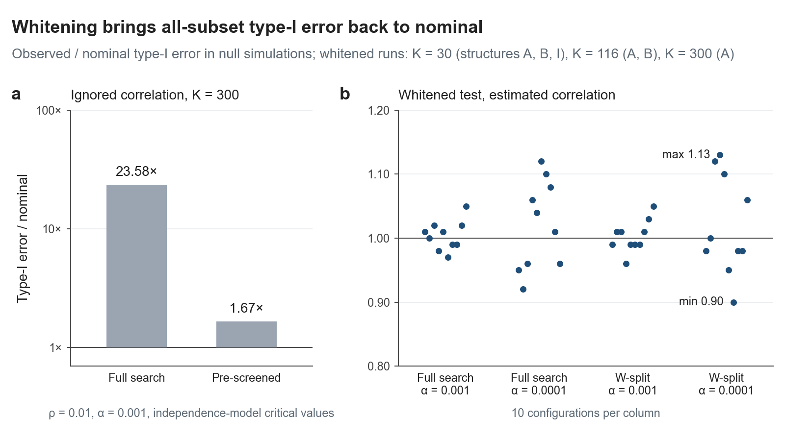

# Exact All-Subset Scanning for Multi-Trait Association Tests

ASSET is a test for whether a genetic variant is associated with some subset of K traits. It maximises a statistic over all 2^K − 1 non-empty subsets, which is usually treated as too many to search. With independent traits the maximum always lies in a prefix of the traits sorted by z-score over weight, so one sort finds it exactly in O(K log K). This is Neill's linear-time subset scanning property applied to ASSET, and a block sweep extends it to block-diagonal correlation. Both agreed with exhaustive search in all 1,700 checks.

The catch is calibration. If the threshold assumes independence while the traits are in fact equicorrelated at 0.01, the full search's type-I error at K = 300 and α = 0.001 is about 24 times nominal. In the simulated correlation structures, whitening with a correlation matrix estimated from null data keeps it between 0.90 and 1.13 times nominal. When every off-diagonal estimated correlation is 0.003 too small, the whitened full search runs at 1.1 to 1.8 times nominal.



---

## 1. Research question

ASSET (Bhattacharjee et al., 2012) tests a variant against K traits by maximising a weighted fixed-effect statistic over all non-empty trait subsets,

Z(S) = Σ_{k∈S} w_k z_k / sqrt(w_Sᵀ R_SS w_S),  T = max_S Z(S),

with w_k = √n_k (or 1/s_k). Because the search space has 2^K − 1 subsets, ASSET and fastASSET (Qi et al., 2024) treat the full search as intractable for many traits; fastASSET therefore searches only traits that pass a univariate pre-screen.

1. Can the maximum over all subsets be computed exactly without enumeration, and under which correlation structures?
2. How should the null distribution of the full-search statistic be calibrated for K = 30 to 300 at genome-wide levels (5e-8)?
3. How sensitive is the full search to weak between-trait correlation that is ignored, as in the independence model or in fastASSET's block rule (|ρ| < 0.2 treated as zero)?
4. Can a whitened full-subset test keep the nominal type-I error when the correlation matrix is estimated, and what power does it retain?

## 2. Methods

### 2.1 Exact maximisation
Code: `code/independence_model/asset_exact.py`, `code/independence_model/asset_core.py`, `code/independence_model/exact_search_checks.py`.

- **Prefix property (independent traits).** Write a_k = w_k z_k, b_k = w_k², r_k = z_k / w_k, and a(S) = Σ_{k∈S} a_k, b(S) = Σ_{k∈S} b_k. Any subset that is a local maximum under single additions and removals with a(S) > 0 has the form S = {k : a_k > 0, r_k > a(S) / (2 b(S))}. Hence the global maximum over all 2^K − 1 subsets is attained on one of the K prefixes of the traits sorted by z_k / w_k, computable in O(K log K). This holds for the published weights (√n_k or 1/s_k).
- **Two-sided version.** ASSET's two-sided statistic searches positive-sign and negative-sign traits separately and combines them by Fisher's method; the prefix property applies within each sign.
- **Block-diagonal correlation.** With independent blocks, a and b are additive over blocks; at the optimum each block's chosen subset maximises a_B − λ b_B with λ = a / (2b). Sweeping λ over the vertices of each block's upper convex hull of (b_B, a_B) gives the exact optimum at cost O(Σ_B 2^{|B|}(|B|² + convex hull)).
- **Dense correlation.** With correlation in the denominator, the optimum satisfies a threshold-plus-grey-zone fixed-point rule in checks against exhaustive search (`code/whitened_test/check_fixedpoint.py`); §3.1 reports how often the prefix scan misses it.

Derivations of the prefix property and the block sweep are in `PROOFS.md`.

### 2.2 Calibration
Code: `code/independence_model/run_null.py`.

- The original DLM (discrete local maximum) approximation is evaluated against simulation; for equal weights the 2^K − 1 terms are collapsed into K terms by subset size.
- Tail probabilities down to 1e-10 are computed by importance sampling with a product "sparse-to-dense" mixture proposal, checked against plain Monte Carlo at 1e-3 and 1e-4.
- The pre-screened version is calibrated by a DLM conditional on the number of traits passing the screen.

### 2.3 Weak correlation
Code: `code/independence_model/null_equicorr.py`, `code/independence_model/null_corr_check.py`.

Critical values from the independence model are applied to null z-vectors drawn under (i) equicorrelation ρ = 0.01, 0.03, 0.1 and (ii) the 44 × 44 null correlation matrix of GTEx v6 (`vhat`).

### 2.4 Whitened full-subset test
Code: `code/whitened_test/`.

- **Whitening.** The z-vector is transformed as z̃ = c · R̂^{-1/2} z, where R̂ is the full estimated correlation matrix, M is the number of null vectors used to estimate it, and c = sqrt((M − K − 1)/M) is the inverse-Wishart correction. On z̃ the prefix property is exact again.
- **W-split.** The main design, W-split, rejects if the whitened full search exceeds its critical value at 0.8α or the whitened pre-screened statistic exceeds its critical value at 0.2α. Critical values come from a one-off independent-null table.
- **Correlation structures.** The simulations use three structures:
  - A: diffuse weak positive correlation.
  - B: small strong blocks on a weak background.
  - I: independent traits.
- **Simulation settings.**
  - Number of traits: K = 30, 116 and 300.
  - Estimation sample: R̂ is estimated from M = 1e4 or 4e4 null vectors.
  - Under-estimation: a systematic under-estimation b = 0.003 of every off-diagonal entry of R̂, so each off-diagonal estimated correlation is 0.003 too small.

## 3. Main results

### 3.1 Exact search
- Prefix scan and block sweep vs. exhaustive search: 0 mismatches in 1,700 checks — 550 independent cases (K = 12: 400, K = 14: 150), the same 550 cases for the two-sided version, and 600 random block-diagonal cases (300 block sweep + 300 vectorised sweep) (`results/independence_model/exact_search_vs_exhaustive.txt`; `results/independence_model/vectorised_block_sweep_vs_exhaustive.txt`).
- Block sweep cost per variant (Python, block plus 20 singletons): block size 12, 0.919 s; block size 15, 6.045 s (`results/independence_model/block_sweep_cost.txt`).
- Dense correlation, K = 12, 200 cases each: the prefix scan misses the optimum in 14/40/61 cases at equicorrelation 0.1/0.3/0.5 and in 22/96/123 cases under single-factor mixed-sign correlation 0.1/0.3/0.5, with maximum relative gap up to 0.3792 (`results/independence_model/prefix_scan_dense_correlation.txt`).

### 3.2 Calibration
- At 5e-8 the DLM approximation is conservative for the full-search statistic and degrades with K: DLM/true tail ratio 1.68 (K = 30), 156.92 (K = 116), about 6.9 × 10^7 (K = 300) (`results/independence_model/null_calibration_k30_equal_weights.txt`, `null_calibration_k116_equal_weights.txt`, `null_calibration_k300_equal_weights.txt`). Importance sampling gives relative standard errors at 5e-8 of 0.03, 0.07 and 0.15 for K = 30, 116, 300 (same files).
- The conditional DLM of the pre-screened version gives an observed/nominal type-I ratio at 5e-8 of 0.574, 0.721, 0.974, 0.986 for K = 30, 44, 116, 300 (`results/independence_model/fastdlm_typeI.json`).

### 3.3 Sensitivity to ignored weak correlation
- Equicorrelation, K = 300, α = 1e-3, critical value from the independence model: type-I error inflated **23.58×** for the full search at ρ = 0.01 and 86.08× at ρ = 0.03; the pre-screened version 1.67× and 4.17× (`results/independence_model/type1_equicorrelation_k300.txt`).
- GTEx v6 null correlation (44 tissues; off-diagonal |ρ| median 0.024, max 0.198, no pair ≥ 0.2, so fastASSET's block rule treats all tissues as independent; `results/independence_model/gtex_null_correlation_stats.txt`): full-search type-I inflation **3.21×, 7.87×, 21.25×** at α = 1e-2, 1e-3, 1e-4; pre-screened version 1.10×, 1.17×, 1.35× (`results/independence_model/type1_gtex_null_correlation.txt`).

### 3.4 Power under the independence model (α = 5e-8, calibrated critical values)
Diffuse signal (optimal-subset non-centrality 7): full search 0.459 / 0.136 / 0.051 vs. pre-screened 0.088 / 0.001 / 0.000 for K = 30 / 116 / 300. Sparse strong signal (2 traits): full search 0.281 / 0.001 / 0.000 vs. pre-screened 0.684 / 0.553 / 0.371 (`results/independence_model/power_k30_equal_weights.txt`, `power_k116_equal_weights.txt`, `power_k300_equal_weights.txt`).

### 3.5 Whitened full-subset test
- With random estimation error in R̂ and b = 0, the observed/nominal type-I ratio of the whitened full search and of W-split at 1e-3 and 1e-4 lies in **0.90–1.13** across the ten simulated configurations (K = 30 with structures A and B at M = 1e4 and 4e4 and structure I at M = 1e4; K = 116 with A and B at M = 1e4 and 4e4; K = 300 with A at M = 1e4) (`results/whitened_test/summary.txt`). Under the same conditions the unwhitened full search is inflated, e.g. 4.38× at 1e-3 for K = 30, structure A (`results/whitened_test/summary.txt`).
- With a systematic under-estimation b = 0.003 (M = 4e4, structures A and B), the whitened full search runs at 1.12 / 1.14 times nominal at 1e-3 for K = 30 and 1.30 / 1.46 for K = 116, and at 1.20 / 1.16 and 1.69 / 1.82 at 1e-4; W-split runs at 1.11 / 1.09 and 1.25 / 1.42 at 1e-3, and at 1.22 / 1.11 and 1.32 / 1.68 at 1e-4 (`results/whitened_test/summary.txt`).
- Power at 5e-8 with information-matched signals (`results/whitened_test/summary.txt`, power table): for K = 116, diffuse signal, the whitened full search reaches 0.148 under independence and 0.032 / 0.037 under structures A / B; for sparse signals W-split retains 0.80–0.87 of the pre-screened version's power (K = 30 and 116).

## 4. Relation to existing work

- **Neill (2012, JRSS-B)** introduced the linear-time subset scanning (LTSS) property; the prefix property in §2.1 is its application to the ASSET statistic. The block sweep extends it to block-diagonal correlation.
- **ASSET** (Bhattacharjee et al., 2012, AJHG) defines the subset statistic and the DLM approximation and enumerates subsets.
- **fastASSET** (Qi et al., 2024, Nat Commun) pre-screens traits, decorrelates within clusters with |ρ| ≥ 0.2 and ignores correlation between clusters.
- **TraitScan** (Cao et al., 2024, Bioinformatics) applies LTSS with ZCA whitening of the full correlation matrix to higher-criticism and truncated chi-square statistics in multi-trait GWAS, and describes ASSET as requiring exhaustive search. This project applies the same whitening-plus-scan principle to the ASSET statistic and adds the inverse-Wishart correction, a one-off importance-sampling null table at 5e-8, and a sensitivity analysis for systematic under-estimation of the correlation matrix.

## 5. Data

- GTEx v6 multi-tissue eQTL summary statistics from the `stephenslab/gtexresults` repository (file `data/MatrixEQTLSumStats.Portable.Z.rds`, 66,560,266 bytes, used in Urbut et al.'s mash paper): strong set 16,069 genes × 44 tissues and the 44 × 44 null correlation `vhat`.
- `code/independence_model/read_rds.py` converts the RDS file to `downloads/gtexresults_v6/gtex_v6_z.npz`, the path expected by `run_gtex.py` and `null_corr_check.py`.
- All other results use simulated data; the repository contains the text summaries derived from the simulation arrays (`.npz`).

## 6. Repository layout

```
PROOFS.md                             derivations of the prefix property and the block sweep
code/
  independence_model/
    asset_exact.py                    single-file exact search and power check
    asset_core.py                     statistics, prefix and block sweeps, DLM, importance sampling
    exact_search_checks.py            proposition checks against exhaustive search
    run_null.py, run_power.py         null calibration and power
    null_equicorr.py, null_corr_check.py   type-I under ignored correlation
    read_rds.py, run_gtex.py          GTEx v6 parser and analysis
  whitened_test/
    whitened_core.py, evaluation_sim.py, run_sim_batch.py   whitened test, simulation driver
    predict_reference.py, derivation_checks.py, design_check_whitened_vs_glrt.py, check_fixedpoint.py
    summarize_results.py              -> results/whitened_test/summary.txt
results/
  independence_model/                 proposition checks, null calibration and power per K,
                                      type-I under ignored correlation, GTEx summaries, critical values (*.json)
  whitened_test/                      null_*.json, pow_*.json, predict_*.json, summary.txt
figures/
  make_figures.py, summary.png        summary figure shown above
```

Scripts are written for Python 3.10 with NumPy and SciPy; run them from their own directory, e.g. `python exact_search_checks.py p123` in `code/independence_model/`.

## License

MIT, see `LICENSE`.
